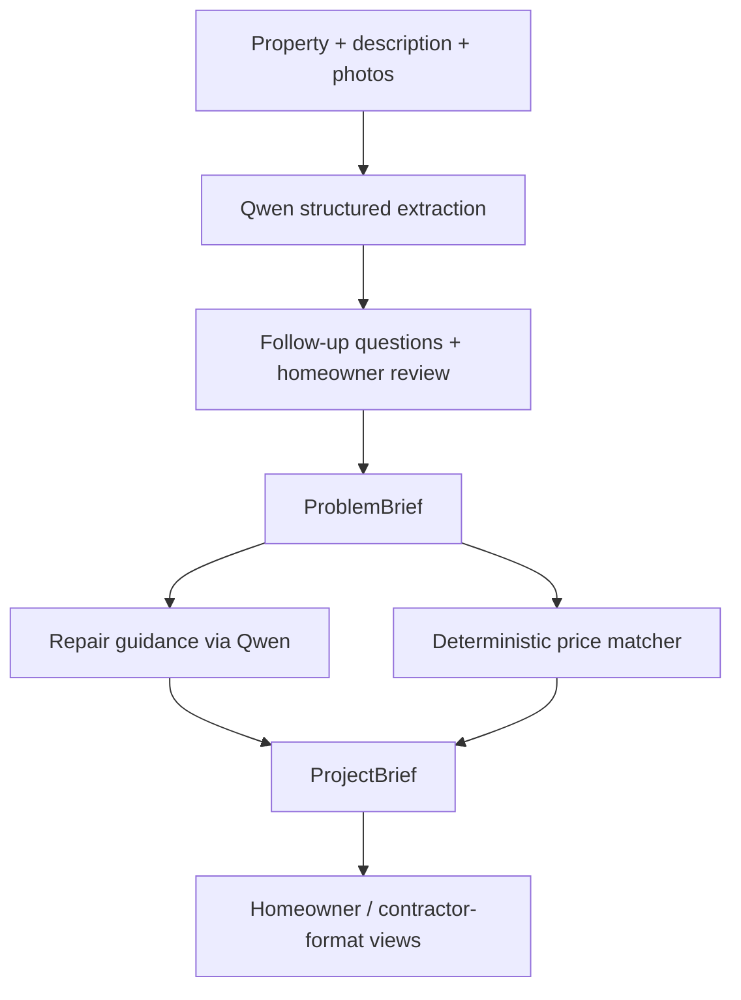

# RenoAI

**AI-assisted home-repair intake, structured triage, and evidence-constrained pricing for Singapore homes.**

RenoAI is a mobile-first MVP that helps homeowners describe a repair problem, clarify missing details, review a structured brief, and receive indicative repair guidance. It separates **LLM-generated repair analysis** from a **deterministic SGD price-matching engine**. When there is not enough evidence for a specific job match, the pricing engine returns **unavailable** rather than inventing a quote.

[Hosted demo](https://reno-ai-three.vercel.app/) · [Architecture](docs/architecture.md) · [Source code](https://github.com/jingxiangong/RenoAi)

> **Status:** Prototype / portfolio project. The demo may require Google authentication and configured external services. This is not a contractor marketplace, a professional diagnosis, a guaranteed quote, or a production-security certification.

## The problem

Home-repair requests often start with incomplete information: a leaking pipe, a door that will not close, or an unfamiliar noise. Homeowners may not know which details matter, while repair staff need a clear scope before they can respond. RenoAI helps structure the first conversation without removing human review.

## How it works

1. **Describe:** Select a property, enter a repair issue and optional category, and attach photographs when useful.
2. **Clarify:** Qwen extracts a structured problem analysis and suggests missing questions.
3. **Review:** The homeowner can edit and confirm a `ProblemBrief` in the normal UI flow.
4. **Analyse:** Repair guidance and deterministic price matching run independently from the brief.
5. **Present:** The system merges both outputs into a `ProjectBrief` for homeowner and contractor-format views, saved requests, and browser print-to-PDF.



**Important distinction:** Confirmation is part of the normal UI workflow; not every backend route independently enforces a persisted confirmation event. Repair suggestions and model-reported confidence are not verified professional conclusions.

## Data engineering and pricing design

The pricing subsystem uses versioned data, explicit quality checks, and an abstention rule. Its goal is to avoid turning incomplete repair descriptions into arbitrary numbers.

| Stage | Repository-backed implementation |
| --- | --- |
| Curated pricing records | [`price-knowledge-base.json`](data/pricing/price-knowledge-base.json) contains **51** eligible pricing jobs for the bundled runtime dataset. |
| Review queue | [`price-needs-review.json`](data/pricing/price-needs-review.json) holds **49** jobs needing more comparable evidence or clearer scope before use. |
| Structural checks | [`validate-pricing.mjs`](scripts/validate-pricing.mjs) checks unique job codes, nonempty matching fields, numeric price boundaries, and SGD currency. |
| Database publication | [`generate-price-migration.mjs`](scripts/generate-price-migration.mjs) generates SQL upserts for the versioned PostgreSQL price table. |
| Price retrieval | [`repository.ts`](src/server/pricing/repository.ts) reads from Supabase and falls back to bundled records when the remote query fails. |
| Evidence-based matching | [`matcher.ts`](src/server/pricing/matcher.ts) requires both a relevant item and a specific symptom; missing or competing matches produce no estimate. |

A displayed range comes from an eligible reference row. It is **not** an LLM-generated price, an ML forecasting model, or an independently validated market appraisal. A historical summary in the repository mentions 348 raw records and 100 normalized jobs; the raw inputs needed to reproduce those totals are not preserved in this checkout. The verifiable versioned artifacts are the 51 eligible jobs and 49 review entries.

**Example:** A report of a door rubbing the floor can match an eligible door-alignment reference. A report mentioning only “door,” or one compatible with several equally plausible jobs, should return **price unavailable** instead of a fabricated figure.

## Architecture and stack

| Concern | Implementation |
| --- | --- |
| Web application | Next.js 16, React 19, TypeScript |
| AI | Qwen vision-language model through an OpenAI-compatible API |
| Runtime contracts | Zod schemas at selected AI and API boundaries |
| Processing | Next.js route handlers, parallel repair and price operations |
| Storage | Supabase PostgreSQL, versioned JSON data, Supabase Storage |
| Authentication | Auth.js with Google OAuth |
| Deployment | Vercel configuration and linked hosted demo |

```text
src/app/                 Pages, API routes and auth actions
src/features/            Repair intake, review, result and requests UI
src/schemas/             Shared structured data contracts
src/server/ai/           Qwen integration and prompts
src/server/pipeline/     Repair + pricing orchestration
src/server/pricing/      Pricing repository, matcher and engine
data/pricing/            Versioned pricing data and review queue
scripts/                 Validation and SQL migration generation
supabase/migrations/     Database and storage migrations
infra/daytona/           Optional sandbox tooling; not a verified CI gate
infra/nosana/            Planned asynchronous video integration
```

## Running locally

Use a supported **Node.js 22+** environment and your own credentials. Different features require different external services.

```bash
git clone https://github.com/jingxiangong/RenoAi.git
cd RenoAi
npm ci
cp .env.example .env.local
npm run dev
```

Configure `AUTH_SECRET`, `AUTH_GOOGLE_ID`, and `AUTH_GOOGLE_SECRET` for Google sign-in. For deterministic example repair analysis, set `AI_DEMO_MODE=true`; this **does not bypass authentication**, and media/cloud operations still need their Supabase settings. For live Qwen analysis, configure `QWEN_API_KEY`, `QWEN_BASE_URL`, and `QWEN_MODEL` with server-side credentials.

Data-related commands:

```bash
node scripts/validate-pricing.mjs
npm run generate:price-migration
npm run build
```

**Note:** The migration generator overwrites its target SQL file; review the diff before applying it to a database. Do not commit `.env.local`, API keys, real addresses, homeowner media, or private data.

## Scope and known limitations

- **Source-implemented:** guided text/photo intake, structured clarification, editable UI review, repair analysis, deterministic pricing, local request history, Supabase integration code, and contractor-format presentation.
- **PDF:** export buttons currently call the browser print dialog; no dedicated server-side PDF-generation API is implemented.
- **Video:** video upload/storage is distinct from video understanding. The Nosana worker remains a planned integration, not an operating evidence-processing service.
- **Daytona:** there is an optional validation launcher; it should not be described as a functioning automated CI gate without dependency and execution verification.
- **Quality and security:** automated behavioral test coverage and production-grade account/media isolation are not yet demonstrated. Use synthetic information in demos. The UI also needs to remove hard-coded repair observations so results always reflect traceable facts.
- **Pricing:** ranges are indicative; source lineage, representativeness and real-world accuracy still require validation.

## Engineering focus

The codebase demonstrates decisions around **data validation, quality-based inclusion/exclusion, PostgreSQL publishing, fallback retrieval, deterministic matching and AI/price separation**. These system-level capabilities are documented here without assigning unverified individual authorship. Personal contribution claims and collaborator credit should be added from confirmed work history and relevant PR/commit evidence.
